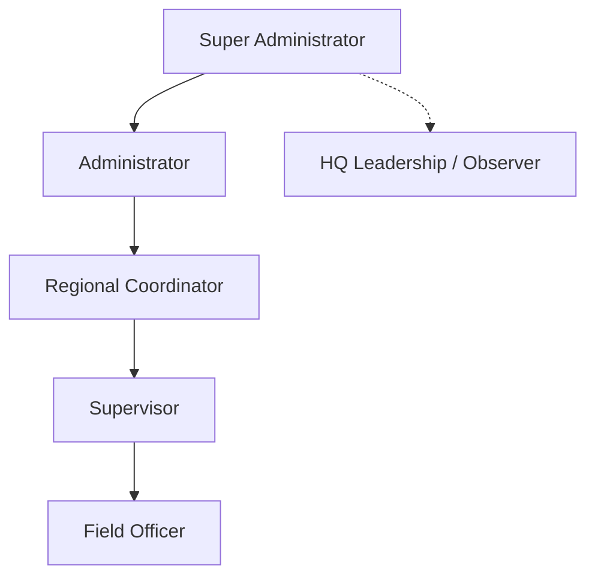
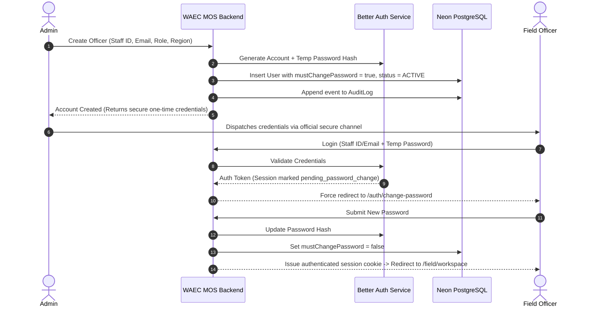
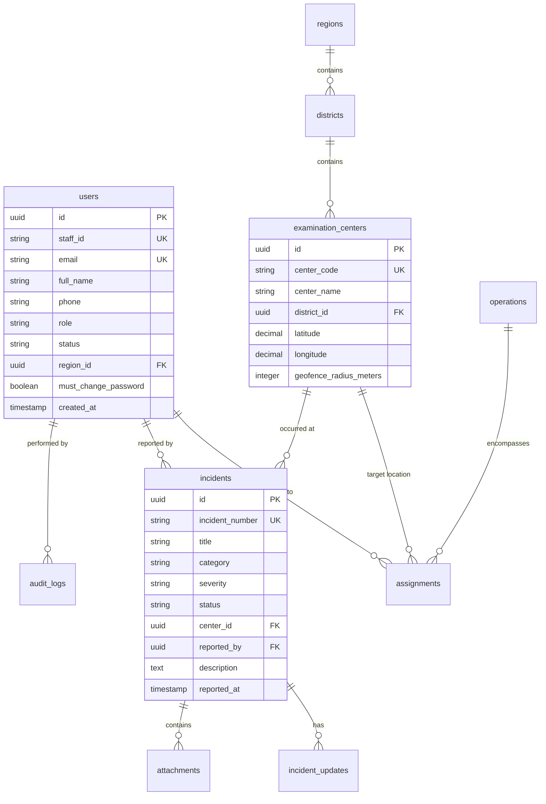
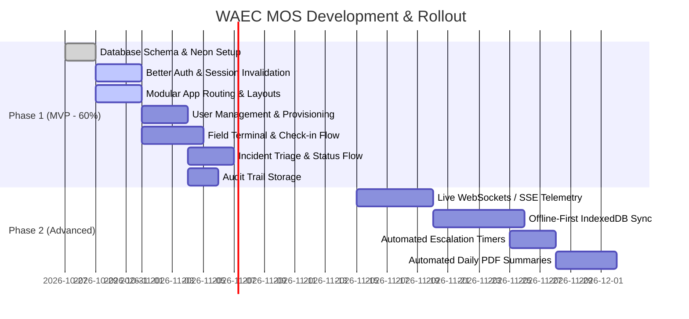

# WAEC Monitoring & Operations System (MOS)
## Product Requirements Document (PRD)

| Document Metadata | Value |
| :--- | :--- |
| **Product Name** | WAEC Monitoring & Operations System (WAEC MOS) |
| **System Category** | Enterprise Security & Examination Field Operations Management |
| **Author** | WAEC Technical Operations & Product Team |
| **Status** | Approved Specification |
| **Target Platforms** | Responsive Web (Desktop Command Console + Mobile Field PWA) |
| **Target Version** | v1.0.0 (MVP 60% Scope Target) |

---

## 1. Executive Summary & Vision

The **West African Examinations Council (WAEC) Monitoring & Operations System (MOS)** is a centralized, mission-critical operations and dispatch platform engineered to safeguard the integrity of national and regional examinations. 

Currently, operational management across examination centers relies heavily on fragmented channels: phone calls, WhatsApp groups, paper logbooks, and disparate spreadsheets. This leads to information lag, lack of accountability, untracked security incidents, and slow response to examination malpractice or logistics failures.

**WAEC MOS** unifies the entire operational lifecycle:
1. **Real-time Field Telemetry & Geofenced Presence:** Verification that field officers, supervisors, and inspectors are physically present at examination centers before accreditation and paper commencement.
2. **Instant Incident Escalation & Response Triage:** Rapid dispatch for distress signals (SOS), examination malpractice, missing materials, or venue emergencies with auditable resolution workflows.
3. **Role-Scoped Command & Governance:** Strict administrative controls over personnel, credentials, regional data silos, and operational records.
4. **Complete Auditability:** Non-repudiation of all actions, check-ins, status transitions, and managerial decisions.

---

## 2. Product Objectives & Key Results (OKRs)

### Strategic Objectives
- **Centralize Field Operations:** Single source of truth for all active operations, patrol runs, and personnel allocations.
- **Zero Self-Registration / Closed Security Model:** Closed ecosystem where only designated administrators can provision field credentials.
- **Rapid Incident Mitigation:** Reduce mean time to detect (MTTD) and mean time to respond (MTTR) for high-severity examination incidents from hours to under 5 minutes.
- **Operational Non-Repudiation:** Fully auditable log trail for legal compliance, regulatory inquiries, and post-examination malpractice investigations.

### Measurable Key Results (KPIs)
- **>= 95%** successful first-time logins for deployed field officers without IT intervention.
- **100%** compliance with forced password change on initial credential activation.
- **< 3 seconds** latency for critical incident broadcasting to regional and HQ command consoles.
- **100%** immediate session termination upon administrative account revocation or suspension.
- **>= 90%** of assignments acknowledged within 15 minutes of issuance.
- **0** unauthorized cross-region data access incidents.

---

## 3. User Roles, Personas & Permission Matrix

### 3.1 Role Descriptions

#### 1. Super Administrator (HQ Command)
- Full system governance across all countries, regions, and districts.
- Provisions and revokes Administrator accounts.
- Accesses global system configuration, security telemetry, and master audit logs.
- Immutable protection against downgrade or removal by other administrators.

#### 2. Administrator (National / Head Office Operations)
- Manages supervisor and field officer rosters within authorized national scope.
- Creates operations, master center allocations, and district boundaries.
- Manages incident lifecycles, reassigns owners, and reviews operational summaries.
- Executes temporary credential generation and password resets.

#### 3. Regional Coordinator (Regional Operations Office)
- Scoped strictly to assigned region(s) (e.g., Ashanti, Greater Accra, Western).
- Assigns supervisors to district zones and exam center clusters.
- Monitors regional fleet deployment, check-in compliance, and live incident queues.
- Approves submitted daily patrol summaries and regional operational briefs.

#### 4. Supervisor (District / Cluster Lead)
- Leads an on-ground cluster of examination centers and field officers.
- Distributes shift tasks, monitors officer battery and GPS connectivity status.
- Acknowledges and investigates reported incidents; escalates critical distress signals to HQ.
- Validates checkpoint completion and approves end-of-shift checkouts.

#### 5. Field Officer (Invigilator / Center Inspector / Patrol Officer)
- Strictly mobile/field user; **cannot self-register**.
- Authenticates using admin-issued Staff ID / Email and temporary password.
- Subject to compulsory first-login password rotation.
- Checks in and out of assigned examination centers using GPS location verification.
- Logs incident reports (photos, evidence, timestamps) and triggers emergency SOS distress beacons.

---

### 3.2 Granular Permissions Matrix

| Capability / Action | Super Admin | Admin | Regional Coord | Supervisor | Field Officer |
| :--- | :---: | :---: | :---: | :---: | :---: |
| **System Settings & Global Config** | ✅ | ❌ | ❌ | ❌ | ❌ |
| **Create / Manage Administrators** | ✅ | ❌ | ❌ | ❌ | ❌ |
| **Create / Manage Field Staff Accounts** | ✅ | ✅ | Scoped (View/Assign) | ❌ | ❌ |
| **Revoke / Suspend Sessions** | ✅ | ✅ | ❌ | ❌ | ❌ |
| **View Cross-Region Data** | ✅ | ✅ | ❌ | ❌ | ❌ |
| **View Regional Operational Fleet** | ✅ | ✅ | ✅ | Scoped (Cluster) | ❌ |
| **Create Operations & Patrol Tasks** | ✅ | ✅ | ✅ | ✅ | ❌ |
| **Execute Check-in / Geofence Verification**| ❌ | ❌ | ❌ | ✅ | ✅ |
| **Submit Incident / Distress SOS** | ❌ | ❌ | ❌ | ✅ | ✅ |
| **Triage / Resolve Incident** | ✅ | ✅ | ✅ | ✅ (Investigate) | ❌ |
| **Export Audit Logs & Compliance Data** | ✅ | ✅ | Scoped (PDF/CSV) | ❌ | ❌ |
| **Change Own Password** | ✅ | ✅ | ✅ | ✅ | ✅ |

---

## 4. Account Lifecycle & Authentication Architecture

### 4.1 Strict Zero-Registration Policy
Public registration endpoints are entirely disabled. Any attempt to hit `/api/auth/sign-up` or `/register` must return `403 Forbidden`. Accounts are exclusively provisioned through the administrative User Management interface or authorized bulk CSV import.

### 4.2 Account Lifecycle States
- **PENDING_ACTIVATION:** Provisioned by admin, temporary credentials generated, awaiting first login.
- **ACTIVE:** Operating normally, verified password.
- **SUSPENDED:** Temporarily locked due to disciplinary review or suspicious activity; sessions terminated.
- **REVOKED:** Permanent decommission or immediate field removal; all tokens blacklisted; active assignments unassigned.
- **ARCHIVED:** Post-examination operational archival for data retention and audit compliance.

### 4.3 Password & Recovery Policy
- Passwords must meet OWASP enterprise standards: minimum 10 characters, upper, lower, digit, special character.
- Field officers requesting recovery enter Staff ID or verified work email.
- System responds with a generic confirmation message ("If the account exists, instructions have been dispatched") to prevent user enumeration.
- Password reset tokens expire in 15 minutes and can only be consumed once.

---

## 5. Core Functional Modules

### Module A: National & Regional Operations Dashboard (Command Console)
- **Fleet Telemetry Map:** Vector/tile map depicting examination centers with color-coded operational states:
  - 🟢 **Green:** Verified On-Site (Geofence satisfied, check-in confirmed).
  - 🟡 **Amber:** En Route / Approaching Center (Within transit window).
  - 🔴 **Red (Blinking):** Active Distress (SOS triggered) or Critical Malpractice Incident.
  - ⚪ **Gray:** Unreported / Pending Deployment.
- **Live Fleet Counters:** Real-time counts of Total Deployed, Verified On-Site, In Transit, and Critical Incidents.
- **Regional Hierarchy Selector:** Quick drilling down from National $\rightarrow$ Region $\rightarrow$ District $\rightarrow$ Center Cluster $\rightarrow$ Individual Officer.
- **Active Inspector Sidebar:** Instant profile card showing active officer battery %, distance to center geofence boundary, last telemetry heartbeat timestamp, and emergency voice/dispatch contact triggers.

### Module B: Field Officer Terminal (Mobile PWA Workspace)
- **Officer Status Widget:** Simple shift states: `OFF DUTY`, `ON PATROL`, `VERIFIED ON SITE`, `REPORTING`.
- **Center Geofencing Engine:** Geolocation verification checking user's device coordinates against center coordinates with configurable tolerance ($\pm 50$ meters).
- **One-Touch Check-in:** Enabled only when within geofence radius. Records device latitude, longitude, accuracy score, and UTC timestamp.
- **Hold-to-Activate SOS Emergency Beacon:** 1.5-second held gesture prevents accidental activation while triggering instant high-priority alerts across regional and HQ monitors.
- **Assignment Details:** Time windows, subject paper, center supervisor contact, special inspection instructions.

### Module C: Incident Management & Escalation Engine
- **Incident Categorization:**
  - Examination Malpractice (Leakage, unauthorized material, impersonation).
  - Security Threat (Intrusion, mob disturbance, exam center vandalism).
  - Logistics Failure (Missing question packets, damaged answer scripts).
  - Medical / Health Emergency.
  - Environmental / Venue Disaster (Power failure, heavy flooding).
- **Severity Levels:** `LOW`, `MEDIUM`, `HIGH`, `CRITICAL`.
- **Incident Lifecycle:** `REPORTED` $\rightarrow$ `ACKNOWLEDGED` $\rightarrow$ `INVESTIGATING` $\rightarrow$ `RESOLVED` $\rightarrow$ `CLOSED`.
- **Evidence Vault:** Compressed photo uploads, audio recordings, or witness statements securely attached to the incident record.
- **Automated Escalation Timers:** If a `CRITICAL` or `HIGH` incident is unacknowledged within 10 minutes, notification automatically elevates to Regional Coordinator and National Admin.

### Module D: User & Workforce Management
- Searchable, filterable personnel directory.
- Filters by Region, District, Operational Role, Account Status, and Center.
- Account creation modal with auto-generated secure temporary passkeys.
- Instant Revocation & Session Invalidation with compulsory audit justification note.
- Bulk CSV onboarding for thousands of examination inspectors prior to exam season.

### Module E: Audit Log & Non-Repudiation Engine
Every write operation records:
1. `Actor ID` (User performing the action).
2. `Action Type` (e.g., `USER_REVOKED`, `INCIDENT_CREATED`, `CHECK_IN_LOGGED`, `PASSWORD_ROTATED`).
3. `Target Entity` (`users`, `incidents`, `assignments`).
4. `Metadata`: Client IP address, user-agent string, GPS coordinates (where applicable).
5. `Diff State`: Pre-change snapshot vs. post-change snapshot (JSONB).

---

## 6. Data Architecture & Database Schema

The database is built on **PostgreSQL (hosted on Neon)** with connection pooling.

### Table Definitions

1. `users`
   - `id`: UUID PRIMARY KEY DEFAULT gen_random_uuid()
   - `staff_id`: VARCHAR(50) UNIQUE NOT NULL
   - `email`: VARCHAR(255) UNIQUE NOT NULL
   - `password_hash`: VARCHAR(255) NOT NULL
   - `full_name`: VARCHAR(255) NOT NULL
   - `phone`: VARCHAR(50)
   - `role`: VARCHAR(50) NOT NULL CHECK (role IN ('SUPER_ADMIN', 'ADMIN', 'REGIONAL_COORD', 'SUPERVISOR', 'FIELD_OFFICER'))
   - `status`: VARCHAR(50) DEFAULT 'ACTIVE' CHECK (status IN ('ACTIVE', 'SUSPENDED', 'REVOKED', 'ARCHIVED'))
   - `region_id`: UUID REFERENCES regions(id)
   - `must_change_password`: BOOLEAN DEFAULT true
   - `last_login_at`: TIMESTAMP WITH TIME ZONE
   - `created_at`: TIMESTAMP WITH TIME ZONE DEFAULT NOW()
   - `updated_at`: TIMESTAMP WITH TIME ZONE DEFAULT NOW()

2. `regions` & `districts`
   - `regions`: `id`, `name`, `code`, `country_code`
   - `districts`: `id`, `region_id`, `name`, `code`

3. `examination_centers`
   - `id`: UUID PRIMARY KEY DEFAULT gen_random_uuid()
   - `center_code`: VARCHAR(50) UNIQUE NOT NULL
   - `center_name`: VARCHAR(255) NOT NULL
   - `district_id`: UUID REFERENCES districts(id)
   - `latitude`: DECIMAL(10, 8) NOT NULL
   - `longitude`: DECIMAL(11, 8) NOT NULL
   - `geofence_radius_meters`: INTEGER DEFAULT 100

4. `operations` & `assignments`
   - `operations`: High-level exam period container (e.g. "WASSCE SC 2026", "BECE 2026").
   - `assignments`: Links an officer to a center, specific date, subject paper, and time window.
   - States: `PENDING`, `ACKNOWLEDGED`, `ON_SITE`, `COMPLETED`, `CANCELLED`, `OVERDUE`.

5. `incidents` & `incident_updates`
   - Tracks incident logs, severity, assignment links, evidence media URLs, investigator notes, and resolution signatures.

6. `audit_logs`
   - Immutability enforced: No `UPDATE` or `DELETE` grants on this table.
   - `id`, `actor_id`, `action`, `entity_type`, `entity_id`, `details` (JSONB), `ip_address`, `user_agent`, `created_at`.

---

## 7. Security, Non-Repudiation & Threat Modeling

| Threat Vector | Mitigation Strategy in WAEC MOS |
| :--- | :--- |
| **Credential Harvesting / Phishing** | Forced first-login password change; no self-registration; rate-limited auth endpoints; generic auth failure messages. |
| **Geofence GPS Spoofing** | Calculate client-side timestamp vs server timestamp delta; inspect HTML5 GPS accuracy metric (`coords.accuracy <= 30m`); verify consecutive heartbeats against reasonable physical travel speed. |
| **Rogue Disgruntled Officer Access** | Immediate session revocation: when status is set to `REVOKED`, active session tokens are wiped in Redis / DB session store, immediately blocking subsequent API calls. |
| **Cross-Regional Data Snooping** | Database queries scoped automatically at the ORM/Data Access Layer using the authenticated session's `region_id` and `role`. |
| **Audit Log Tampering** | Audit log table has write-only permissions for application user; strict append-only constraints; changes in status capture previous and new states. |
| **Man-in-the-Middle (MitM)** | Enforced TLS 1.3, HSTS header, secure `HttpOnly`, `SameSite=Lax` cookies. |

---

## 8. MVP (60% Scope) vs. Future Releases

### In-Scope for 60% Release:
1. Complete Next.js App Router structure with protected layout barriers.
2. Full Better Auth integration with Postgres/Neon backing.
3. Super Admin & Admin user provisioning, revocation, and password reset flows.
4. Field Officer workspace with real HTML5 geolocated check-in.
5. Incident logging with severity levels and supervisor/admin review dashboard.
6. Core Audit Logging for administrative actions.
7. Responsive UI matching the WAEC deep navy, slate, and yellow color identity.

### Deferred to Post-MVP:
- Offline IndexedDB queuing with background service workers.
- Native iOS/Android wrapping via Capacitor/React Native.
- SMS / WhatsApp Gateway integration for fallback notifications.
- Advanced statistical analytics on exam center malpractice trends.

---

## 9. Non-Functional & Reliability Requirements

- **Availability:** 99.9% uptime during active examination examination blocks (May-June WASSCE, Nov-Dec Nov/Dec series).
- **Page Load Time:** Dashboard first contentful paint (FCP) $\le 1.2\text{s}$ on standard 4G broadband; mobile terminal bundle size $\le 300\text{KB}$ compressed.
- **Data Protection:** Personal Identifiable Information (staff phone numbers, email) encrypted in transit and at rest.
- **Device Support:** Fully compatible with Android Chrome (v90+) and iOS Safari (iOS 15+) for field personnel devices.
- **Browser Accessibility:** WCAG 2.1 AA compliant color contrast ratios across both desktop HQ console and mobile field terminals.

---

## 10. Acceptance Criteria Checklist

- [ ] Unauthenticated users are redirected to `/auth/login` when requesting any protected dashboard route.
- [ ] No public signup route exists or accepts requests.
- [ ] Admin can create a Field Officer account with staff ID, and system flags `mustChangePassword = true`.
- [ ] Field officer is prevented from navigating the app on initial login until password rotation is completed.
- [ ] When an account is marked `REVOKED`, active session cookies are invalidated and subsequent requests immediately return `401 Unauthorized`.
- [ ] Field officer cannot check in if GPS distance exceeds the configured geofence radius of the center.
- [ ] Incidents created by field officers appear on the Regional and National command consoles with real-time severity styling.
- [ ] Audit log accurately registers actor, action, timestamp, and target entity for every administrative modification.
- [ ] Build succeeds with full TypeScript type safety (`tsc --noEmit` passes without errors).

---
*End of Product Requirements Document — WAEC MOS v1.0.0*
